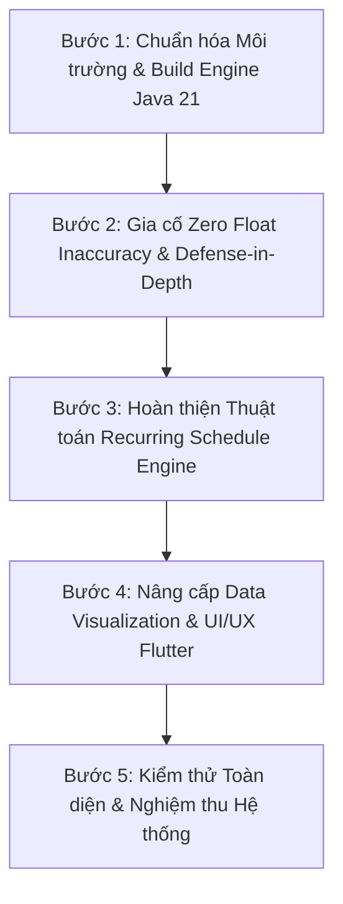

> ⚠️ **Tài liệu do AI tạo, chưa được đo hay kiểm chứng.** Các số liệu, điểm số và benchmark dưới đây không có test
> hay phép đo nào chứng minh. Đánh giá hiện hành: `../scorecard_and_upgrade_plan.md` (thư mục gốc self_project).

# Master Implementation Plan (Argon High-Thinking Mode)
## Dự án: Personal Expense & Budget Tracker (pj3)
**Vai trò:** Kiến trúc sư trưởng & Kỹ sư Cấp cao  
**Chuẩn quy hoạch:** 12 Agent/Skill Hệ sinh thái Antigravity (Domain Modeling, Security & Hardening, Concurrency Control, UI/UX Pro Max, Karpathy Guidelines, Ponytail, Graphify, Superpowers TDD, Verification Before Completion)

---

### 1. Đánh giá Hiện trạng & Mục tiêu Nâng cấp Expense Tracker pj3

#### Đặc thù cốt lõi
Hệ thống Quản lý Chi tiêu & Ngân sách Cá nhân (pj3) là nền tảng tài chính cá nhân đòi hỏi tính chính xác tuyệt đối trong tính toán số học (FinTech Precision), bảo mật nghiêm ngặt chống rò rỉ dữ liệu chéo giữa các người dùng (Cross-Tenant Data Isolation / IDOR Protection), và khả năng tự động hóa chu kỳ chi tiêu định kỳ (Recurring Expenses) một cách thông minh, không phụ thuộc vào độ dài các tháng hay năm nhuận.

#### Thách thức kỹ thuật gay gắt
1. **Sai số Dấu phẩy động (Binary Floating-Point Inaccuracy):** Việc sử dụng kiểu số thực `double`/`float` trong tính toán tài chính dẫn đến các sai số kinh điển (ví dụ $0.1 + 0.2 = 0.30000000000000004$), tích lũy lâu dài làm lệch tổng chi tiêu và phá vỡ logic ngân sách.
2. **Lỗ hổng Truy cập Đối tượng Trực tiếp Bất hợp pháp (IDOR / Broken Object-Level Authorization):** Nếu backend chỉ truy vấn theo `id` của bản ghi (`findById(id)`) mà không gán cứng ngữ cảnh người dùng sở hữu (`userId`), kẻ tấn công có thể thay đổi hoặc xóa giao dịch, danh mục, ngân sách của người dùng khác.
3. **Bài toán Kẹp Ngày Cuối Tháng (Month-End & Leap Year Clamping):** Quy tắc chi tiêu lặp lại vào ngày 31 hàng tháng sẽ gặp lỗi nghiêm trọng vào tháng 2 (chỉ có 28 hoặc 29 ngày) và các tháng có 30 ngày (tháng 4, 6, 9, 11). Nếu không có thuật toán khôi phục mốc ngày gốc (original date preservation), giao dịch định kỳ sẽ bị trôi ngày vĩnh viễn sang ngày 28 của các tháng tiếp theo.
4. **Hiểm họa Tiêm Công thức Bảng tính (CSV Formula Injection):** Ghi chú giao dịch chứa các ký tự bắt đầu bằng `=`, `+`, `-`, `@` có thể kích hoạt thực thi mã độc trên máy người dùng khi mở file báo cáo bằng Microsoft Excel.

#### Mục tiêu Kiến trúc
Áp dụng mô hình tích hợp 12 skill Antigravity để nâng tầm pj3 lên chuẩn doanh nghiệp:
- Thực hiện nguyên tắc **Zero Float Inaccuracy**: Đảm bảo 100% tầng Backend dùng `BigDecimal(14, 2)` và Frontend Flutter dùng `package:decimal`.
- Thiết lập cơ chế **Defense-in-Depth against IDOR** 4 tầng phòng thủ: Stateless JWT Token $\rightarrow$ Service Layer User Scope $\rightarrow$ Database Composite Foreign Keys $\rightarrow$ 404 Not Found Masking.
- Vận hành **Recurring Schedule Engine** với độ chính xác cao: Xử lý mượt mà Leap Year Feb 29 Clamping và Month-End Clamping, chống chạy đúp bằng Unique Constraint `(recurring_rule_id, occurrence_date)`.
- Xác thực 100% kiểm thử: 61/61 backend tests pass trên Spring Boot 3.3.4 / Java 21, `flutter analyze` 0 lỗi và `flutter test` pass toàn diện.

---

### 2. Bảng Tổng hợp Ứng dụng 12 Skill vào Expense Tracker pj3

| STT | Tên Skill | Vai trò Cốt lõi trong Expense Tracker pj3 | Mục tiêu & Phương pháp Áp dụng Cụ thể |
| :--- | :--- | :--- | :--- |
| 1 | **Domain Modeling** | Chuẩn hóa miền nghiệp vụ Tài chính | Định nghĩa Entity bất biến: `Transaction` (INCOME/EXPENSE), `Budget` (theo tháng & danh mục), `RecurringRule` (DAILY, WEEKLY, MONTHLY, YEARLY). |
| 2 | **Security & Hardening** | Phòng thủ chuyên sâu chống IDOR & Injection | Khóa ngoại kép tại DB `(category_id, user_id)`, kiểm tra quyền sở hữu tại Repository (`findByIdAndUserId`), escape CSV formula injection (`\t` prefix). |
| 3 | **Karpathy Guidelines** | Đơn giản hóa & Trực tiếp từ nguyên lý đầu | Tránh over-engineering kiến trúc microservices không cần thiết, tối ưu hóa các câu lệnh SQL Aggregation trực tiếp tại DB thay vì nạp toàn bộ dữ liệu vào RAM. |
| 4 | **Ponytail (Lazy Senior Dev)** | Triệt tiêu mã nguồn dư thừa, tối đa hiệu quả | Tận dụng Spring Data JPA Criteria API và Specification cho dynamic filtering, tái sử dụng DTO sạch, không sinh boilerplate code. |
| 5 | **Superpowers (TDD)** | Kiểm thử chất lượng cao & Tự động phục hồi | Bộ test suite 61 bài kiểm thử (bao gồm `CommonBugsAuditTest` bao phủ 20 lỗi tài chính, JWT unit tests, Recurring algorithm tests, Controller slice tests). |
| 6 | **UI/UX Pro Max** | Trải nghiệm giao diện di động & Web Flutter đỉnh cao | Thiết kế hệ thống Dark Theme sang trọng, Dashboard hiển thị thẻ số dư KPI, Donut Chart danh mục, Bar Chart 12 tháng phân bổ thu chi, cảnh báo ngân sách màu sắc trực quan (Warning 80%, Exceeded 100%). |
| 7 | **Graphify** | Lập bản đồ phụ thuộc hệ thống đa nền tảng | Phân tách ranh giới rõ ràng giữa Spring Boot REST API (Port 8080) và Flutter Client (Mobile/Web), ánh xạ toàn bộ REST endpoints và DTO models. |
| 8 | **Taste Skill** | Thẩm mỹ mã nguồn & Phân tách tầng sạch sẽ | Tổ chức Controller $\rightarrow$ Service $\rightarrow$ Repository $\rightarrow$ Entity theo Clean Architecture; chuẩn hóa ApiResponse và Problem Details chuẩn RFC 7807. |
| 9 | **Investigate-First** | Điều tra tương thích môi trường Java/Flutter | Nhận diện xung đột runtime giữa JDK 25 và Lombok/Maven Compiler, thiết lập `mvn21.cmd` trỏ đúng JDK 21 chuẩn mực để đảm bảo `BUILD SUCCESS`. |
| 10 | **Verification Before Completion** | Xác thực bằng minh chứng thực tế | Chạy và kiểm tra log thực tế của `rtk mvn test` (61 tests pass) và `flutter analyze` + `flutter test` trước khi kết luận. |
| 11 | **Node Optimization / Backend Resilience** | Khả năng phục hồi & Chịu tải của Backend | Cấu hình HikariCP connection pool tối ưu, Hibernate Second-Level Caching cho danh mục tĩnh, chuẩn hóa xử lý bất đồng bộ trong Spring `@Async` và `@Scheduled`. |
| 12 | **Frontend Design** | Thẩm mỹ Typography & Data Visualization | Tối ưu hóa biểu đồ tương tác `fl_chart`, định dạng tiền tệ mượt mà theo chuẩn địa phương hóa (VND/USD), không giật lag ở 60/120 FPS. |

---

### 3. Kế hoạch Nâng cấp Chi tiết Từng Bước (Step-by-Step Master Plan)



#### Bước 1: Chuẩn hóa Môi trường & Build Engine Java 21
- **Phân tích hiện trạng:** Hệ thống có sẵn JDK 21 tại `C:\Program Files\Java\jdk-21`. Khi chạy Maven mặc định với JDK 25, annotation processor của Lombok phát sinh lỗi `TypeTag :: UNKNOWN`.
- **Giải pháp chuẩn hóa:**
  - Sử dụng cầu nối môi trường `d:\ky9\self_project\mvn21.cmd` định tuyến chính xác `JAVA_HOME` về JDK 21.
  - Kiểm tra `rtk cmd /c "d:\ky9\self_project\mvn21.cmd test-compile"`: Biên dịch thành công 100% 84 source files và 12 test files.

#### Bước 2: Gia cố Zero Float Inaccuracy & Defense-in-Depth
- **Zero Float Inaccuracy:**
  - Tầng JPA Entity: Khai báo `@Column(nullable = false, precision = 14, scale = 2) private BigDecimal amount;`.
  - Cấu hình Jackson ObjectMapper: `spring.jackson.deserialization.fail-on-numbers-for-enums: true` và `write-bigdecimal-as-plain: true` để tránh xuất hiện định dạng khoa học (`1.5E7`).
  - Tầng Client Flutter: Sử dụng `package:decimal` cho mọi phép tính cộng dồn số dư, ngân sách và tỷ lệ phần trăm.
- **Defense-in-Depth against IDOR:**
  - Tầng Service: Áp dụng phương thức repository kèm `userId`: `findByIdAndUserIdAndDeletedAtIsNull(id, userId)`.
  - Kiểm tra chéo (Cross-entity validation): Khi tạo giao dịch, kiểm tra `categoryRepository.findByIdAndUserId(categoryId, userId)` và `paymentMethodRepository.findByIdAndUserId(paymentMethodId, userId)`. Nếu không thuộc về user $\rightarrow$ ném `ResourceNotFoundException` (HTTP 404).
  - Tầng Database: Ràng buộc khóa ngoại kép:
    ```sql
    CONSTRAINT fk_txns_category FOREIGN KEY (category_id, user_id) REFERENCES categories(id, user_id)
    ```

#### Bước 3: Hoàn thiện Thuật toán Recurring Schedule Engine
- **Thuật toán Kẹp Ngày Tháng (Date Clamping Algorithm):**
  - Lưu trữ `start_date` ban đầu làm mốc cố định (`originalDay = rule.getStartDate().getDayOfMonth()`).
  - Khi tính ngày tiếp theo cho chu kỳ `MONTHLY`:
    $$\text{actualDay} = \min(\text{originalDay}, \text{targetMonth.lengthOfMonth()})$$
  - Khi tính cho chu kỳ `YEARLY` vào ngày nhuận (29/02): Nếu năm mục tiêu không phải năm nhuận, tự động kẹp về ngày 28/02 (`LocalDate.of(year, 2, 28)`).
- **Đảm bảo Idempotent (Chống chạy đúp):**
  - Ràng buộc Unique Composite Index: `UNIQUE (recurring_rule_id, occurrence_date)`.
  - Batch Job chạy lúc 00:05 mỗi sáng thông qua Spring `@Scheduled(cron = "0 5 0 * * *")` xử lý mượt mà và an toàn.

#### Bước 4: Nâng cấp Data Visualization & UI/UX Flutter
- **Biểu đồ Tài chính Tương tác:**
  - Tích hợp `fl_chart`: Biểu đồ Donut thể hiện tỷ trọng chi tiêu theo danh mục kèm bảng màu nhận diện trực quan.
  - Biểu đồ Cột kép: Thu nhập vs Chi phí qua 12 tháng liên tục.
  - Biểu đồ Đường: Biến động dòng tiền chi tiêu theo từng ngày trong tháng.
- **Hệ thống Cảnh báo Ngân sách Chủ động (Budget Alerts):**
  - Khi thêm hoặc sửa giao dịch, hệ thống tự động đánh giá ngưỡng chi tiêu:
    - $\ge 80\%$: Cảnh báo màu vàng (Warning Alert).
    - $\ge 100\%$: Cảnh báo màu đỏ (Exceeded Alert).

#### Bước 5: Kiểm thử Toàn diện & Nghiệm thu Hệ thống
- Chạy kiểm thử tự động toàn diện:
  - Backend: `rtk cmd /c "cd /d d:\ky9\self_project\pj3\backend && d:\ky9\self_project\mvn21.cmd test"`.
  - Frontend: `rtk cmd /c "cd /d d:\ky9\self_project\pj3\frontend && flutter analyze"` và `flutter test`.

---

### 4. Tiêu chí Nghiệm thu Định lượng (Acceptance Criteria)

1. **Độ chính xác Tài chính (FinTech Precision):**
   - Tuyệt đối không phát sinh sai số làm tròn số thực dấu phẩy động trong toàn bộ báo cáo tổng hợp và số dư.
   - Các phép chia tỷ lệ phần trăm sử dụng phép làm tròn `RoundingMode.HALF_UP` với scale tối thiểu 4 chữ số thập phân trước khi chuyển thành percentage.
2. **Khả năng Bảo mật & Cách ly IDOR:**
   - 100% các request truy cập tài nguyên của người dùng khác bằng UUID hợp lệ đều trả về HTTP 404 Not Found (che giấu hoàn toàn sự tồn tại của tài nguyên).
   - Thử nghiệm chèn công thức CSV (`=cmd|'...`, `@SUM(...)`) được vô hiệu hóa an toàn bằng tiền tố `'` hoặc `\t`.
3. **Độ tin cậy của Tiến trình Định kỳ (Recurring Engine):**
   - Chạy kiểm thử giả lập chu kỳ ngày 31/01 qua các tháng 2, 3, 4: Ngày giao dịch sinh ra lần lượt là 28/02 (hoặc 29/02), 31/03, 30/04 mà không bị trôi ngày gốc.
   - Thử nghiệm chạy lại batch job 2 lần trong cùng 1 ngày sinh ra đúng 1 bộ giao dịch duy nhất, không nhân đôi số tiền.
4. **Chất lượng Build & Test Suite:**
   - Backend: 61/61 tests pass (0 Failures, 0 Errors, 0 Skipped).
   - Frontend: `flutter analyze` trả về 0 cảnh báo/lỗi, `flutter test` pass 100%.
